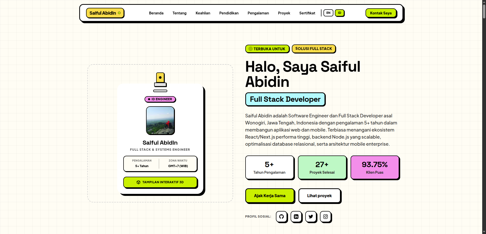
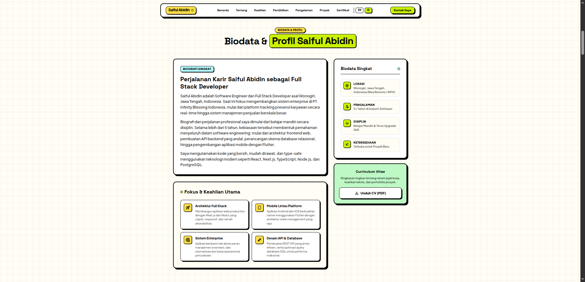
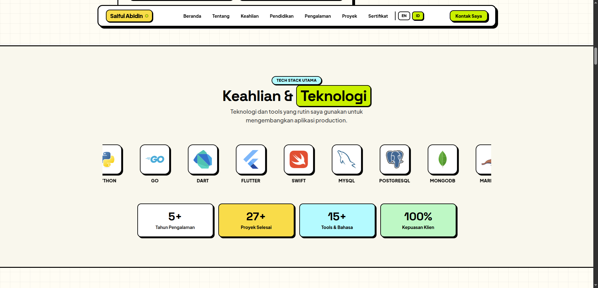
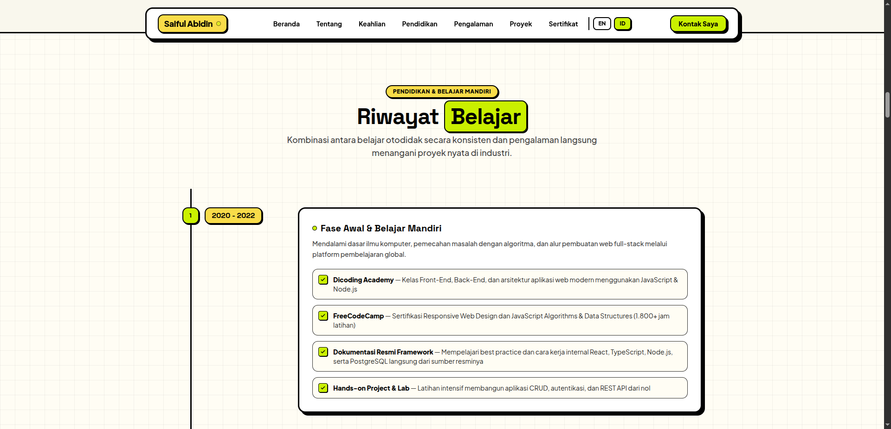
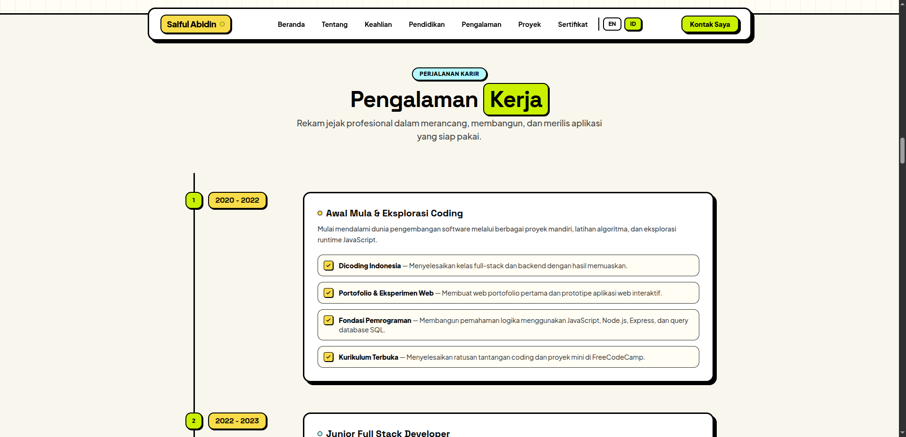
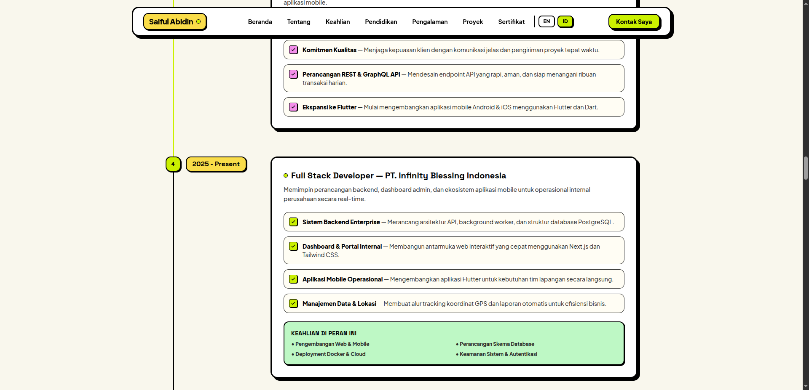
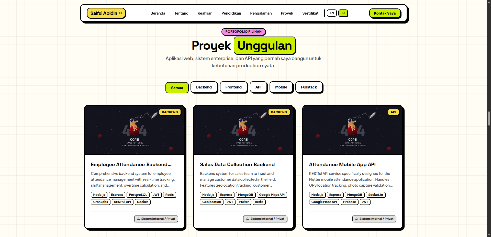
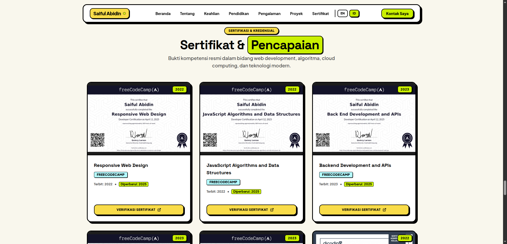
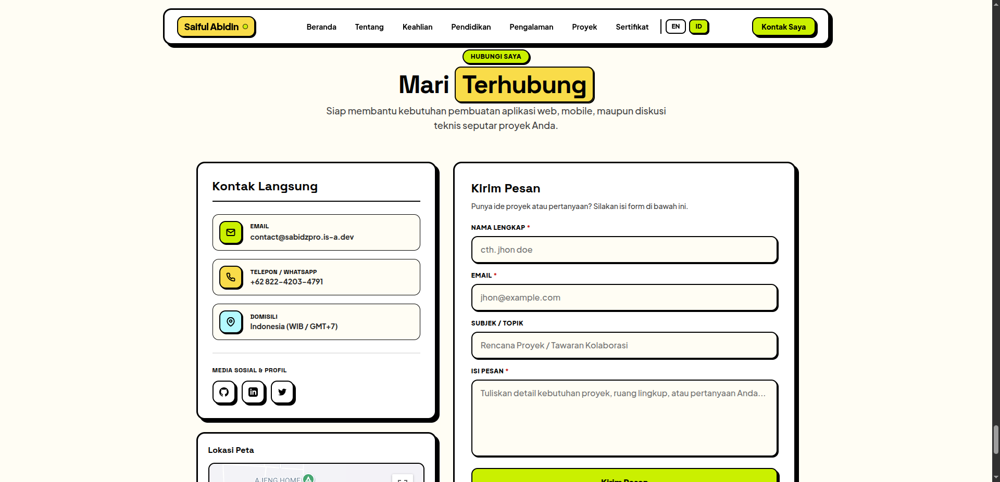

# Saiful Abidin - Personal Portfolio & Engineering Platform

Production-grade personal portfolio and interactive web platform engineered with Next.js 14 App Router, TypeScript, React Three Fiber, Tailwind CSS, Prisma ORM, and the Bun runtime. Features localized routing (ID/EN), 3D interactive physics simulation, administrative content management, and hardened edge security.

[](https://sabidzpro.is-a.dev)
[](https://github.com/saifulabidin/saifulabidin.github.io/stargazers)
[](LICENSE.md)
[](https://nextjs.org/)
[](https://www.typescriptlang.org/)
[](https://bun.sh/)
[](https://tailwindcss.com/)
[](https://www.postgresql.org/)

---

## Visual Tour & Application Showcase

### 1. Hero Section & Interactive 3D Lanyard
Interactive physics-driven lanyard simulation created with Three.js, React Three Fiber, and Rapier Physics, paired with high-level professional metrics and quick action controls.



### 2. Professional Biography & Profile
Concise background detailing 5+ years of software engineering journey, core engineering focus, and direct Curriculum Vitae download link.



### 3. Core Technologies & Skills Marquee
High-density visual inventory of languages, frameworks, databases, and tooling deployed across production environments.



### 4. Education & Self-Directed Learning Timeline
Structured milestone ledger tracking self-taught computer science foundations, algorithm practice, and specialized cloud/full-stack certifications.



### 5. Career Journey & Work Experience
Career progression covering initial explorations, freelance consulting, and leading enterprise backend and mobile operations at PT. Infinity Blessing Indonesia.




### 6. Featured Engineering Projects
Filterable project showcase categorizing full-stack web applications, microservices, mobile apps, and high-throughput REST APIs.



### 7. Verified Certifications & Credentials
Official certifications from FreeCodeCamp, Dicoding Indonesia, and AWS with verifiable credential links.



### 8. Direct Contact & Secure Location Proxy
Direct contact channel with input validation and server-side Google Maps API proxy keeping upstream tokens confidential.



---

## Core Capabilities

- **Internationalization (i18n)**: Subpath routing supporting Bahasa Indonesia (`/id`) and English (`/en`) via `next-intl` with automated language negotiation.
- **Interactive 3D Physics**: WebGL card lanyard rendered with React Three Fiber, Three.js, and Rapier rigid-body physics.
- **Enterprise SEO & Agentic Browsing**:
  - Dynamic `generateMetadata` delivering self-referencing canonical URLs matching localized `hreflang` alternates.
  - JSON-LD structured data (`Person`, `WebSite`, `ProfilePage`).
  - Native machine-readable Agent Discoverability standards compliant with [`/llms.txt`](public/llms.txt) and [`/llms-full.txt`](public/llms-full.txt).
- **Administrative Portal**: Protected administration routes allowing full CRUD lifecycle management for projects and credentials.
- **Authentication**: NextAuth.js v5 (Beta) backed by GitHub OAuth provider.
- **Cloud Object Storage**: File and asset upload handling via Vercel Blob SDK.
- **Edge Security Headers**: Hardened HTTP security headers (CSP, HSTS, X-Frame-Options, X-Content-Type-Options).

---

## Technology Stack

| Layer | Technology | Specification / Role |
| --- | --- | --- |
| Runtime & Package Engine | Bun | v1.2+ execution runtime and lockfile engine |
| Web Framework | Next.js | v14.x App Router (SSG, SSR, Server Actions) |
| Programming Language | TypeScript | v5.x strict mode |
| Styling & UI | Tailwind CSS | Utility-first CSS, custom neo-brutalist theme |
| Motion & Animation | Framer Motion / Motion | Hardware-accelerated UI transitions |
| 3D Simulation | React Three Fiber / Rapier | `@react-three/fiber`, `@react-three/drei`, `@react-three/rapier` |
| Database & ORM | PostgreSQL / Prisma | Prisma ORM v6 with connection pooling |
| Authentication | NextAuth.js | v5 (Beta) session tokens with GitHub OAuth |
| Media Storage | Vercel Blob | Cloud binary asset storage |
| Internationalization | next-intl | Cookie & header-based locale management |
| Deployment & Edge | Vercel | Global edge serverless hosting |
| Containerization | Docker / Caddy | Multi-stage Alpine container with automated HTTPS |

---

## Repository Layout

```text
├── app/
│   ├── [locale]/             # Internationalized route tree (/en, /id)
│   │   ├── cookie-policy/    # Localized cookie compliance page
│   │   ├── privacy-policy/   # Localized privacy policy page
│   │   ├── layout.tsx        # Localized root layout with dynamic metadata
│   │   └── page.tsx          # Single-page portfolio composition
│   ├── api/                  # Edge and serverless route handlers
│   │   ├── admin/            # Authenticated CRUD handlers (projects, certificates)
│   │   ├── auth/             # NextAuth route handler
│   │   ├── maps/             # Confidentially proxied Google Maps handler
│   │   └── public/           # Public read-only endpoints
│   ├── components/           # Reusable UI widgets and 3D canvas modules
│   └── constants/            # Structured data schemas and SEO configurations
├── docs/                     # Media documentation and visual assets
│   ├── screenshots/          # High-resolution application screenshots
│   └── saweria-qr.png        # Saweria donation QR image
├── lib/                      # Core utilities, Prisma client, and routing definitions
├── messages/                 # Translation catalogs (en.json, id.json)
├── prisma/                   # Database schema definitions and seed routines
├── public/                   # Static public assets (fonts, icons, llms.txt)
├── scripts/                  # Maintenance and SEO auditing automation
├── Caddyfile                 # Caddy reverse proxy configuration
├── Dockerfile                # Multi-stage Bun Alpine container specification
├── docker-compose.yml        # Docker service definition
├── GITHUB.md                 # Repository governance and branch standards
├── CONTRIBUTING.md           # Contribution protocol
├── CODE_OF_CONDUCT.md        # Contributor Covenant v2.1
├── SECURITY.md               # Vulnerability reporting and SLA terms
└── LICENSE.md                # MIT License
```

---

## Environment Configuration

Create a `.env` file based on `.env.example`:

```bash
cp .env.example .env
```

| Parameter | Required | Description |
| --- | --- | --- |
| `NEXT_PUBLIC_SITE_URL` | Yes | Canonical site domain (`https://sabidzpro.is-a.dev`) |
| `NODE_ENV` | Yes | Runtime environment mode (`development` or `production`) |
| `POSTGRES_PRISMA_URL` | Yes | PostgreSQL connection string |
| `AUTH_SECRET` | Yes | Cryptographic secret for encrypting session cookies |
| `AUTH_GITHUB_ID` | Yes | GitHub OAuth Client ID |
| `AUTH_GITHUB_SECRET` | Yes | GitHub OAuth Client Secret |
| `BLOB_READ_WRITE_TOKEN` | Yes | Vercel Blob access token |
| `GOOGLE_MAPS_API_KEY` | Yes | Server-side Google Maps token proxied via `/api/maps` |
| `CADDY_EMAIL` | Optional | Let's Encrypt notification address for Docker deployments |

---

## Getting Started

### Prerequisites

- [Bun](https://bun.sh/) v1.2.0 or higher
- Git

### Installation & Local Server

1. Clone the repository:
   ```bash
   git clone https://github.com/saifulabidin/saifulabidin.github.io.git
   cd saifulabidin.github.io
   ```

2. Install dependencies:
   ```bash
   bun install
   ```

3. Generate Prisma client bindings:
   ```bash
   bun run db:generate
   ```

4. Start local development server:
   ```bash
   bun dev
   ```

Access the application at `http://localhost:3000`.

### Database Operations

```bash
# Push schema updates directly to database
bun run db:push

# Execute pending migrations
bun run db:migrate

# Seed database with initial project data
bun run db:seed
```

---

## Production Deployment

### Option 1: Vercel (Recommended)

1. Import the repository in the Vercel dashboard.
2. Vercel automatically detects `bun.lock` and executes the build using Bun.
3. Configure the required environment variables in Project Settings.
4. Deployments execute automatically on git pushes to `main`.

### Option 2: Self-Hosted Container (Docker & Caddy)

```bash
# Build and start services in detached mode
bun run compose:up

# Check container health and status
docker compose ps

# Shutdown containers
bun run compose:down
```

---

## Quality Assurance & Verification

```bash
# Run ESLint validation
bun run lint

# Build production bundle
bun run build

# Run Docker container smoke test
bun run test:docker

# Run SEO & metadata compliance script
bun run seo:check

# Inspect production bundle size
bun run analyze
```

---

## Governance & Documentation

- [Contributing Guidelines](CONTRIBUTING.md)
- [Repository Governance](GITHUB.md)
- [Code of Conduct](CODE_OF_CONDUCT.md)
- [Security Policy](SECURITY.md)
- [License Terms](LICENSE.md)

---

## Support & Sponsorship

If you find this project or portfolio useful, you can support continuous maintenance and open-source contributions via Saweria:

<p align="center">
  <a href="https://saweria.co/sabidzpro">
    
  </a>
  <br />
  <a href="https://saweria.co/sabidzpro">
    <strong>Support via Saweria (saweria.co/sabidzpro)</strong>
  </a>
</p>

---

## License

This project is licensed under the MIT License. See [LICENSE.md](LICENSE.md) for full text.
